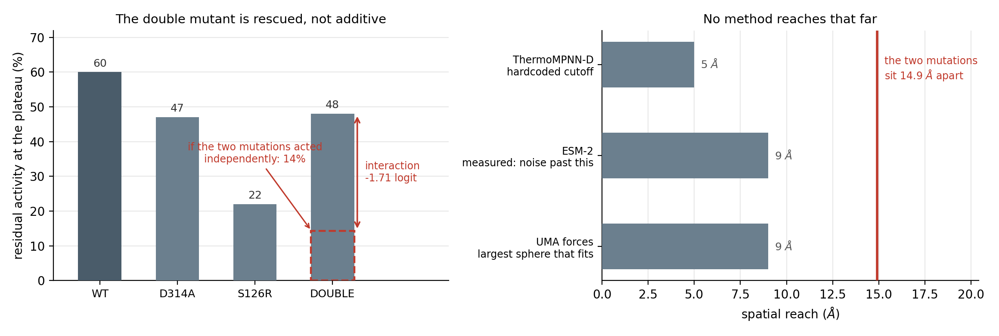

# X3 — UMA: la cuenta es aditiva por construcción, y el efecto no lo es

Fecha: 2026-11-24. Modelo: `uma-s-1p1` (FAIRChem, tarea `omol`).
Estructuras: los cuatro PDB de MOE. Medición digitalizada de figura.
Script: `scripts/uma_forces.py`, análisis en `scripts/analyze_uma_forces.py`.

## La pregunta

¿Las mutaciones son más o menos favorables según lo que calcula UMA?

## Qué se calculó, y por qué eso

**Fuerzas, no energías totales.** La energía total depende de la composición:
Arg tiene más átomos que Ser, así que `E(S126R)` y `E(WT)` no son comparables y
cualquier correlación con ellas estaría leyendo el peso molecular. Una fuerza es
local, va en eV/Å y no depende de cuántos átomos tenga el sistema.

Lo que mide: MOE colocó las cadenas laterales mutadas sobre un esqueleto rígido,
sin dejar que el entorno respondiera. La fuerza es el gradiente de la energía
respecto de las coordenadas, así que un gradiente grande indica que esos átomos
están lejos de un mínimo — que la sustitución no entra cómoda ahí. Es un proxy
del costo estérico, **no** una energía libre, y mide en parte qué tan bien MOE
colocó la cadena lateral.

**Esferas de 9 Å, no la proteína entera.** Protonada son ~7.000 átomos, que no
entran en 11 GB y además están muy fuera del rango en que se entrenó OMol25
(≤350 átomos). Con radio 10 ya hay OOM en algunas posiciones; 9 Å entra siempre
(726–867 átomos).

**Control dentro de cada estructura.** "¿La fuerza es grande?" no tiene respuesta
sola, así que la misma cuenta corre en 20 posiciones al azar de la misma
estructura y la posición vigilada se reporta como z-score contra ese nulo.

## Resultado 1 — el WT ya está tensionado

| posición | z en WT (sin mutar) |
|---|---|
| 126 | +0.76 |
| 314 | +0.68 |

Las dos posiciones vigiladas están ~0.7σ por encima de una posición al azar
**antes de mutar nada**. Entonces el z crudo no es el costo de la sustitución:
una parte ya estaba ahí. Todo lo que sigue es la diferencia contra el WT en la
misma posición.

## Resultado 2 — el valor depende solo del estado local

Fuerza máxima (eV/Å) en cada posición vigilada:

| variante | pos 126 | pos 314 |
|---|---|---|
| WT | 4.594 | 4.480 |
| D314A | 4.412 | **4.064** |
| S126R | **6.516** | 4.480 |
| DOUBLE | **6.514** | **4.064** |

(negrita = la mutación está en esa posición)

En la posición 314, S126R da **exactamente** el mismo valor que el WT, y DOUBLE
da **exactamente** el mismo que D314A. En la 126, DOUBLE y S126R difieren en
0.02%. El valor en una posición queda determinado únicamente por qué hay en esa
posición.

Restando el WT:

| variante | Δz 126 | Δz 314 | suma | meseta medida |
|---|---|---|---|---|
| D314A | −0.12 | **−0.28** | −0.40 | 47 |
| S126R | **+1.32** | 0.00 | +1.32 | 22 |
| DOUBLE | **+1.32** | **−0.28** | +1.04 | 48 |

Tiene sentido físico: S126R mete tensión donde muta, y D314A *relaja* su
posición, consistente con reemplazar una cadena lateral grande por una chica.

**El doble mutante es la suma exacta de los dos simples. El término de
interacción es cero, no chico.**

## Resultado 3 — la medición dice lo contrario

S126R sola baja la actividad residual de 60 a 22. D314A sola la baja a 47. Si
los efectos se sumaran, el doble debería ser peor que cualquiera de los dos.
Está en 48, es decir igual que D314A sola: la segunda mutación cancela a la
primera casi por completo.

En escala logit, `G(A) = −ln(A/(100−A))`, que es donde sumar tiene sentido bajo
el supuesto declarado de partición en dos estados:

```
predicción aditiva del DOUBLE:  +2.20  (equivale a 14% de actividad residual)
observado:                      +0.49  (48%)
epistasia:                      −1.71  — borra el 78% de lo que predice la suma
```

**La cuenta devuelve 0.00 para una cantidad cuyo valor medido es −1.71.**

## Por qué, y por qué no es un defecto de implementación

Las dos posiciones mutadas están a **14.9 Å** (distancia mínima átomo-átomo,
medida en los propios PDB). La esfera más grande que entra en la placa es de
9 Å. Las dos mutaciones nunca están en el mismo cálculo, así que no existe
ningún camino matemático por el cual pueda salir un término de interacción. El
método es **aditivo por construcción**: no estima mal la epistasia, no la puede
expresar.

## El resultado convergente

| método | alcance | motivo |
|---|---|---|
| ThermoMPNN-D | 5 Å | corte escrito en el código |
| ESM-2 | ~9 Å | medido: más allá el acoplamiento es ruido |
| UMA (fuerzas) | 9 Å | lo que entra en 11 GB |
| **el efecto medido** | **14.9 Å** | |

Tres métodos, tres causas sin relación entre sí, la misma ceguera. El fenómeno
vive afuera del alcance espacial de todo el stack disponible.



## Orden predicho contra orden medido

```
por tensión predicha (peor primero):  S126R, DOUBLE, D314A
por pérdida medida   (peor primero):  S126R, D314A,  DOUBLE
```

Coincide en S126R. D314A y DOUBLE están invertidos, pero sus pérdidas medidas
son 13 y 12 puntos, es decir un empate dentro del error de digitalización. Con
n=3 mutantes la p mínima de una permutación exacta es 1/6 = 0.167, así que
ningún orden puede alcanzar significancia: se puede decir si coincide y nada
más.

## Limitaciones, explícitas

1. **n = 3 mutantes.** No hay estadística posible, solo ordenamiento.
2. **La meseta viene de digitalizar una figura publicada**, no de datos crudos.
3. **Las coordenadas son de MOE**, con esqueleto rígido. Las fuerzas miden en
   parte la calidad de ese modelado, no solo la física de la sustitución.
4. **Hay una señal de largo alcance que no es nuestra.** Cambiar 314 movió la
   fuerza en 126 un 4% (4.594 → 4.412) aunque 314 no esté en la esfera. Eso
   viene de que MOE relajó la estructura distinto: está en las coordenadas de
   entrada, no es algo que UMA haya calculado. Es el modelo de MOE del efecto a
   distancia.
5. **Sin metal.** El Fe se excluyó por defecto: es de capa abierta y la cuenta
   se corrió con `spin=1`.

## Qué haría falta para responder la pregunta original

Un método cuyo alcance espacial supere los 15 Å y que pueda tratar las dos
mutaciones en el mismo cálculo. Las opciones, en orden de costo:

- Esferas que contengan ambas posiciones (radio ≥16 Å, >3.000 átomos): requiere
  una placa con más memoria, o particionado del modelo.
- Dinámica molecular con campo de fuerza clásico, que no tiene techo de tamaño
  pero tampoco la precisión electrónica.
- Métodos de energía libre (FEP, TI), que sí estiman el efecto de una mutación
  pero cuestan órdenes de magnitud más.

Ninguno de los tres está en el alcance de este trabajo. El resultado reportable
es el negativo, que está bien delimitado: se midió el alcance de cada método, se
midió la distancia del efecto, y no se tocan.
