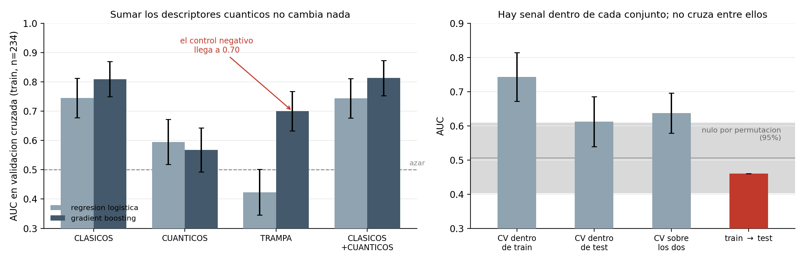

# X5 — Los descriptores energéticos de UMA no aportan nada sobre la toxicidad

Fecha: 2026-11-24. Modelo `uma-s-1p2` (validado en `05-uma-checkpoints.md`).
Datos: TIRESIA, 234 de entrenamiento (CAESAR) + 527 de test, endpoint
toxicidad del desarrollo.
Scripts: `mol_prepare.py`, `mol_descriptors.py`, `mol_quantum.py`,
`mol_analysis.py`, `mol_transfer.py`.

## La pregunta

¿Los valores de energía que da UMA tienen relación con la toxicidad?

## El diseño, y por qué así

La energía total no es comparable entre moléculas distintas: escala con la
composición, así que correlacionarla con toxicidad mide el peso molecular. Por
eso los descriptores se construyeron como diferencias sobre la misma geometría,
aprovechando el condicionamiento por carga de OMol25: IE, EA, y de ahí
electronegatividad χ, dureza η e índice de electrofilia ω = χ²/2η. La
cancelación funcionó: ω correlaciona con el número de átomos a ρ = −0.078.

Cuatro bloques de variables, y el tercero está puesto a propósito:

| bloque | contenido | rol |
|---|---|---|
| CLÁSICOS | 814 descriptores del paper (606 Mordred, 212 RDKit) | baseline |
| CUÁNTICOS | IE, EA, χ, η, ω | lo que se evalúa |
| TRAMPA | energía total, energía por átomo | **control negativo** |
| CLÁSICOS+CUÁNTICOS | | la comparación anidada |

La pregunta útil no es "¿ω correlaciona con toxicidad?". En un conjunto que es
92% tóxico casi cualquier cosa correlaciona. La pregunta es si los cuánticos
aportan **por encima** de los 814 que el paper ya usa.

## Resultado 1 — ningún descriptor cuántico es consistente

AUC de cada descriptor usado solo como puntaje:

| descriptor | AUC train | p | AUC test | p |
|---|---|---|---|---|
| IE | 0.433 | 0.098 | 0.386 | 0.012 |
| EA | 0.559 | 0.15 | 0.422 | 0.085 |
| χ | 0.499 | 0.98 | 0.365 | 0.003 |
| η | 0.386 | 0.005 | 0.520 | 0.67 |
| ω | 0.527 | 0.51 | 0.390 | 0.015 |
| energía total | 0.479 | 0.61 | 0.453 | 0.30 |
| energía por átomo | 0.506 | 0.88 | 0.518 | 0.69 |

η se da vuelta entre conjuntos (0.386 contra 0.520). χ y ω no muestran nada en
entrenamiento y algo en test. **IE es el único con el mismo signo en los dos**
(los tóxicos se ionizan más fácil), pero no alcanza significancia en
entrenamiento y no sobreviviría una corrección por las nueve pruebas hechas,
sobre todo porque χ, ω y EA están fuertemente correlacionados entre sí y no son
pruebas independientes. Es el único hilo del que valdría la pena tirar si el
trabajo continuara; no es un hallazgo.

ω contra toxicidad da ρ = −0.020 (p = 0.59) crudo, y ρ = +0.086 (p = 0.017)
controlando peso molecular y logP. El control lo hace subir en vez de
derrumbarlo, así que no era un confundidor de tamaño — pero +0.086 es el 0.7%
de la varianza.

## Resultado 2 — no aportan nada sobre los clásicos

Validación cruzada repetida (5 pliegues × 10 repeticiones) sobre las 234:

| bloque | AUC (reg. logística) | AUC (gradient boosting) |
|---|---|---|
| CLÁSICOS | 0.745 ± 0.067 | 0.809 ± 0.060 |
| CUÁNTICOS | 0.595 ± 0.077 | 0.568 ± 0.075 |
| TRAMPA | 0.423 ± 0.078 | **0.700 ± 0.067** |
| CLÁSICOS+CUÁNTICOS | 0.744 ± 0.067 | 0.813 ± 0.060 |

Ganancia de sumar los cuánticos: **−0.0009** (p = 0.77) con regresión
logística, **+0.0035** (p = 0.60) con boosting. Las p usan la corrección de
Nadeau-Bengio, obligatoria porque los pliegues comparten datos de
entrenamiento. Sobre el test publicado, el intervalo bootstrap de la diferencia
cruza el cero con los dos modelos.

Es un cero, y está bien medido.

## Resultado 3 — el control negativo delata al conjunto de entrenamiento

La fila TRAMPA es energía total y energía por átomo: nada más que un proxy de
la composición. Con boosting llega a **AUC 0.700** en validación cruzada.

Eso no dice nada sobre química. Dice que las 234 moléculas de entrenamiento
tienen estructura memorizable que no es el fenómeno que se quiere predecir, y
que un modelo flexible la encuentra. Cualquier número de validación cruzada
sobre ese conjunto hay que leerlo con eso en mente, incluido el 0.809 de los
clásicos.

## Resultado 4 — nada transfiere entre los dos conjuntos publicados

| | AUC |
|---|---|
| CV dentro de train (n=234) | 0.743 ± 0.071 |
| CV dentro de test (n=527) | 0.612 ± 0.073 |
| CV sobre los dos juntos (n=761) | 0.637 ± 0.059 |
| **train → test** | **0.460** |
| test → train | 0.561 |

Con 200 permutaciones de las etiquetas de entrenamiento, el nulo de train→test
da media 0.506 y sd 0.052. **El 0.460 real cae en el percentil 20 de ese
nulo**: es un sorteo perfectamente común de "no hay nada que aprender". No es
anti-predictivo, es simplemente vacío.

Hay señal aprendible dentro de cada conjunto y no cruza entre ellos.

## Qué dice y qué no dice esto sobre TIRESIA

**No** dice que TIRESIA no funcione. No se reprodujo su método: ellos usan
XGBoost con su propio ajuste, análisis SHAP y, sobre todo, un **dominio de
aplicabilidad** que filtra las moléculas sobre las que el modelo se pronuncia.
Su rendimiento reportado es sobre el subconjunto que pasa ese filtro, y acá no
se aplicó ninguno.

Sí dice algo acotado y verificable: **con la lista de descriptores que el
propio paper publica y dos familias de modelos estándar, sin filtro de
aplicabilidad, nada de lo aprendido en el conjunto de entrenamiento transfiere
al de test.** Eso vuelve al dominio de aplicabilidad no un refinamiento sino el
componente que sostiene el resultado.

## Limitaciones

1. No se reprodujo el método del paper, solo su conjunto de descriptores.
2. Sin dominio de aplicabilidad.
3. Las geometrías son MMFF, no relajadas con UMA. Las fuerzas residuales son
   grandes (mediana 1.74 eV/Å), así que las energías se evaluaron en puntos
   lejos del mínimo del propio modelo. Es legítimo para una IE *vertical*, pero
   relajar con UMA antes sería más limpio.
4. 4 de los 818 descriptores no se pudieron calcular: `fr_trimethylaniline`,
   `fr_clorobenzene`, `fr_sulph`, `fr_dimetilbutane` no existen con esos
   nombres en RDKit y parecen erratas del material suplementario.
5. Un solo endpoint, y de los más difíciles.

## La respuesta a la pregunta original

No hay relación utilizable entre los valores energéticos de UMA y la toxicidad
del desarrollo en este conjunto. Y es un "no" de los buenos: los descriptores
están validados contra DFT a 0.29 eV, la cancelación de la composición se
verificó, el control negativo se comportó como control negativo en la
comparación honesta, y la ausencia de aporte se midió con intervalo de
confianza en vez de declararse.

El endpoint ayuda a entender por qué. La electrofilia tiene una historia
mecanística para toxicidad *reactiva* — ataque a las partes ricas en electrones
del ADN y las proteínas. La toxicidad del desarrollo tiene muchos mecanismos y
la mayoría no son ese. Esperar que cinco números electrónicos la capturen era
optimista, y ahora está medido en vez de supuesto.
